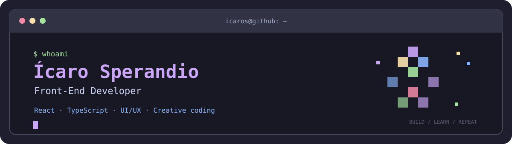

<p align="center">
  
</p>

<h1 align="center">Ícaro Sperandio</h1>

<p align="center">
  <strong>Front-End Developer</strong> · UI/UX Enthusiast · Creative Developer
</p>

<p align="center">
  <a href="https://www.linkedin.com/in/sperandioicaro/">
    
  </a>
  <a href="mailto:sperandioicaro@gmail.com">
    
  </a>
  <a href="https://github.com/SperandioIcaro">
    
  </a>
</p>

---

### `01 / PROFILE`

I build interfaces that feel alive.

I'm a Systems Analysis and Development student with an interest in game design, thoughtful interfaces, and the details that make digital experiences feel intuitive. I enjoy turning ideas into functional products and constantly refining the way they look, feel, and work.

### `02 / TOOLKIT`

<p>
  
  
  
  
  
  
  
</p>

### `03 / CURRENT FOCUS`

```text
> building       polished, responsive interfaces
> learning       deeper React and TypeScript patterns
> exploring      UI/UX, interaction design, and game mechanics
> improving      API integration and backend fundamentals
```

### `04 / FIND ME ONLINE`

- **Portfolio:** [sperandioicaro.vercel.app](https://sperandioicaro.vercel.app/)
- **LinkedIn:** [linkedin.com/in/sperandioicaro](https://www.linkedin.com/in/sperandioicaro/)
- **Projects:** [Browse my repositories](https://github.com/SperandioIcaro?tab=repositories)

---

<p align="center">
  <sub><code>DESIGNED WITH CURIOSITY · BUILT ONE COMMIT AT A TIME</code></sub>
</p>
